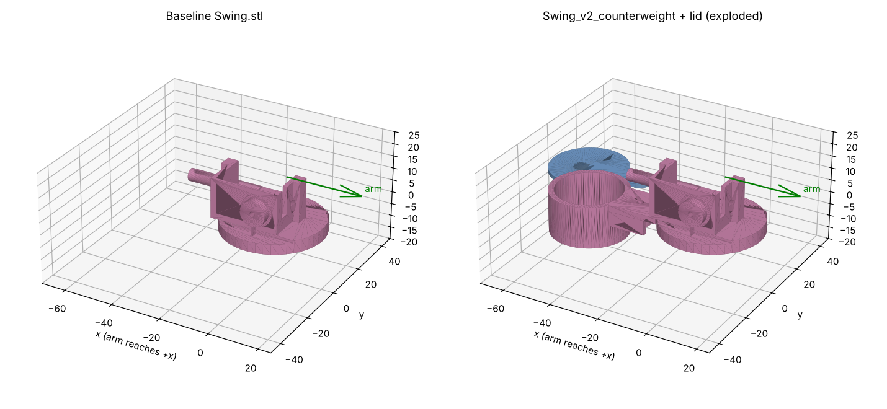

# Swing counterweight (CAD change proposal)

**Problem:** the foot is a light 110 mm "+" shape. With the arm stretched out, especially toward a gap between two foot arms where the support edge is only ~39 mm from the yaw axis, the arm's weight can tip the whole robot forward. It also puts a large side load on the base SG90's output shaft.

**Change:** `Swing_v2_counterweight.stl` is the baseline `Swing.stl` with a weight pocket fused on **behind** the arm (−x, 52 mm from the yaw axis). The Swing is the part the base servo rotates, so the weight turns with it. Whichever way the arm swivels, the weight always points the opposite way. No extra mechanism or servo is needed.



## Parts and hardware

| Item | Notes |
| --- | --- |
| `03_cad/stl/Swing_v2_counterweight.stl` | Replaces `Swing.stl`. Print with the disc face down; the pocket hangs below it, so support it from the build plate. |
| `03_cad/stl/Swing_v2_counterweight_lid.stl` | 1.5 mm lid. Print flat. |
| 7 × UK 2p coins (≈ 50 g) | 25.9 mm coins in a 26.6 mm bore. Fill the 1.3 mm gap with a paper or felt shim so they don't rattle. Any ~50 g of dense filler works: M8 nuts, steel BBs, a lead-free fishing weight. |
| M3 × 10 self-tapping screw | Holds the lid (2.6 mm pilot hole in a boss). Unscrew and lift the lid to change the weight. The Ø10 hole in the floor lets you push the coins out. |

## Clearances checked against the STLs

- **Arm:** the top of the pocket and lid is at z = 4 mm (swing frame), the same height as the original tail tab. The arm's shoulder boss bottoms out at about z = 5 mm even when tilted fully back, so it passes over.
- **Foot post:** the pocket hangs 14.5 mm below the swing disc, at radius 36.5–67.5 mm. The static foot post reaches only r ≈ 23.4 mm, and the swing sits about 10 mm above the post top, so the foot's 3 mm cross arms are well below it. The stiffening ribs start at r = 24 mm.
- **Tail tab:** the original tab (y 16–19 mm) is kept. The pocket clears it by at least 2 mm.
- **To check on the real build:** cable routing from the arm servos down past the swing, and the swing height above the foot post (assumed ≥ 8 mm).

## Sizing (`counterweight_calc.py`)

The masses in the script are **estimates** (STL volumes and 9 g SG90s). Weigh the real parts and edit the list. With the estimates:

| Case | Without counterweight | With 7 × 2p |
| --- | --- | --- |
| Forward tip margin (arm out, diagonal) | −2195 g·mm → **tips over** | +2922 g·mm → stable |
| Backward tip margin (arm tucked) | — | +3364 g·mm → stable |
| Side moment on base servo shaft, arm out | 5695 g·mm | 2788 g·mm |

- About 3 coins is the minimum to stop forward tipping.
- About 54 g balances the servo shaft best across the range between arm out and arm tucked.
- **Trade-off:** yaw inertia rises by about 21 %, so the base accelerates more slowly. Keep the base speed limit, or retune it in the SPD tests. Total added mass is about 57 g.
- This balances the base. It does **not** reduce shoulder-servo torque, which would need a counterweight or spring on link 1 itself.

## Regenerate

```
pip install trimesh manifold3d
python3 03_cad/counterweight/make_swing_counterweight.py   # rebuild STLs (parameters at the top)
python3 03_cad/counterweight/counterweight_calc.py         # re-run sizing with measured masses
```

The design is AI-assisted (Claude Code). Disclose this in the report per the brief.
