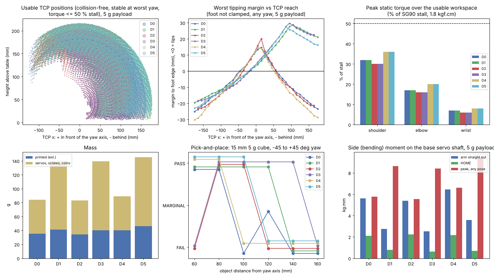
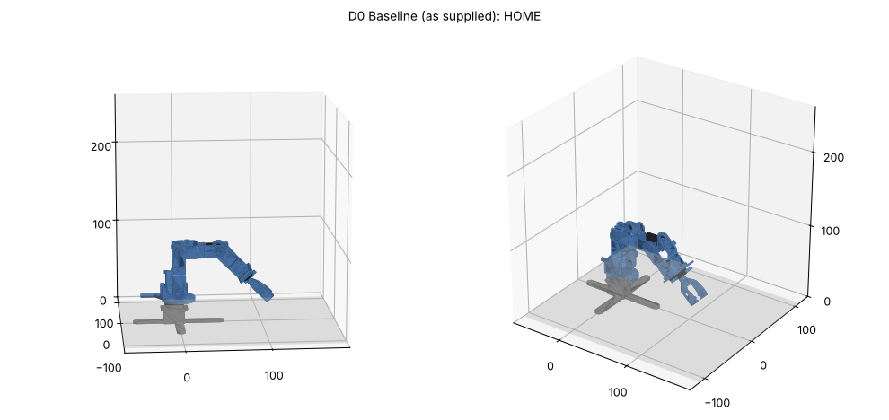
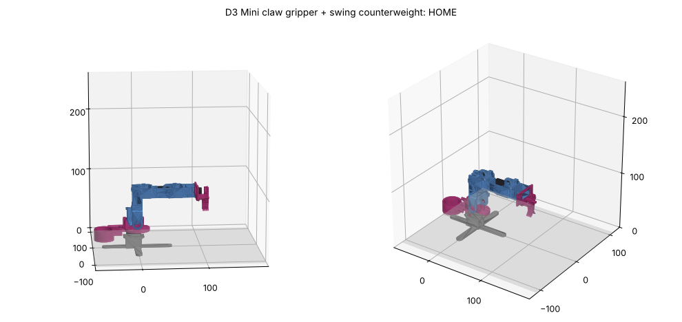
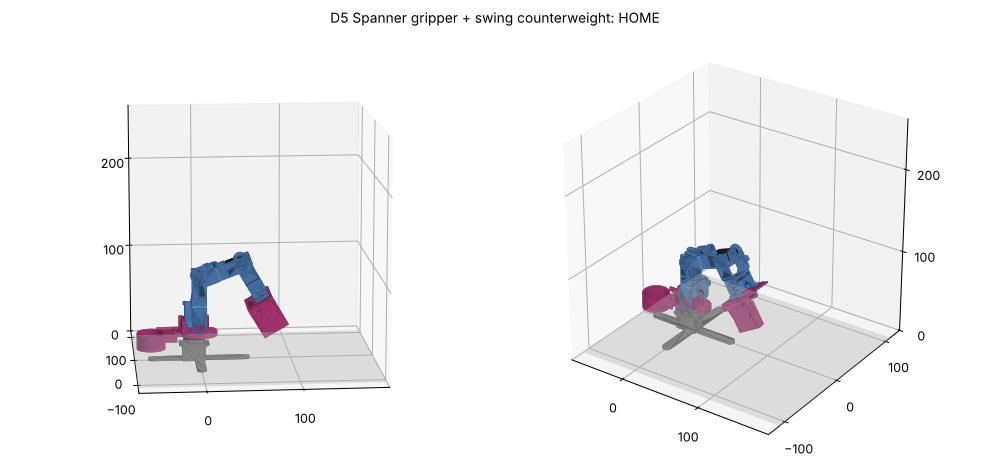

# Full arm designs: combined, simulated and tested

> **Status: simulation only.** Nothing here has been printed or built. These are design-stage results, not measured evidence for `08_tests/`. Every value marked **MEASURE** is an assumption to check on the real arm.
> **AI disclosure:** the model, simulations and this README were produced with AI assistance (Claude Code). The group must check and understand them before using them in the report.

The team has three part redesigns, each on its own branch: two replacement grippers and one swing counterweight. This folder combines them with the 11 supplied parts into **six complete arms**, every valid combination of {original, mini claw, spanner} gripper × {original, counterweight} swing. It then puts each full arm through the same set of simulated tests.



## The six designs

| Key | Gripper | Swing | New / modified parts | Printed parts | Total mass\* |
| --- | --- | --- | --- | --- | --- |
| **D0** | Original rack-and-pinion | Original | – (reference) | 11 | 84 g |
| **D1** | Original rack-and-pinion | **Counterweight** | 2 + 7 × 2p coins | 12 | 140 g |
| **D2** | **Mini geared claw** | Original | 5 | 10 | 83 g |
| **D3** | **Mini geared claw** | **Counterweight** | 7 + coins | 11 | 140 g |
| **D4** | **Spanner** | Original | 4 | 10 | 89 g |
| **D5** | **Spanner** | **Counterweight** | 6 + coins | 11 | 146 g |

\* Printed parts estimated at 3 perimeters + 20 % infill, PLA, plus 5 × SG90 (9 g), horns, screws and coins. Weigh the real parts.

Each design has:

- `assemblies/<key>/<key>_assembly_home.stl` and `.3mf`: the whole arm assembled at HOME. The 3MF keeps each part as a named object. Servos are SG90 envelopes.
- `assemblies/<key>/<key>_bom.csv`: every part, its source STL, whether it's new or modified, and its estimated mass.
- `results/<key>_home.png` and `<key>_reach.png`: renders at HOME and at the furthest stable reach. Pink = new or modified part.
- `results/<key>_results.json`: every number below. `results/<key>_sweep.csv.gz` has every pose tested.

The printable STLs are not duplicated. The BOMs point to the single copy of each file in `00_baseline/3d_models/`, `03_cad/stl/` and `03_cad/mini_claw/stl/`.

| D0 baseline | D3 mini claw + counterweight | D5 spanner + counterweight |
| --- | --- | --- |
|  |  |  |

## Results

### Summary

| Test | D0 | D1 | D2 | D3 | D4 | D5 |
| --- | --- | --- | --- | --- | --- | --- |
| **ASM** interfaces | pass\* | pass\* | pass\* | pass\* | pass\* | pass\* |
| **COL** collision-free poses inside the servo windows | 56.7 % | 56.7 % | 56.5 % | 56.5 % | 55.4 % | 55.4 % |
| **STAB** arm straight out, worst yaw (tip margin) | **−23 mm, tips** | +21 mm | **−21 mm, tips** | +23 mm | **−29 mm, tips** | +16 mm |
| **STAB** stable poses, arm in front (any yaw) | 72 % | **100 %** | 76 % | **100 %** | 68 % | **100 %** |
| **STAB** stable poses, arm reaching back over the tail | 63 % | 51 % | 61 % | 46 % | 60 % | 49 % |
| **TRQ** peak shoulder torque (% of SG90 stall) | 32 % | 32 % | 30 % | 30 % | 36 % | 36 % |
| **TRQ** peak elbow / wrist torque | 17 / 7 % | 17 / 7 % | 16 / 6 % | 16 / 6 % | 20 / 8 % | 20 / 8 % |
| **WS** furthest usable forward reach, TCP 0–30 mm above table | 131 mm | **176 mm** | 117 mm | 161 mm | 120 mm | **175 mm** |
| **PNP** pick-and-place radii passed (of 60–160 mm) | 60, 80 (+120 marginal) | **60–120** | 80, 100 | **80–140** | 60, 80 | 60–100 |
| **YAW** base side moment, arm straight out | 5.6 kg·mm | 2.8 | 5.4 | **2.5** | 6.5 | 3.6 |
| **YAW** base side moment, HOME | 2.1 kg·mm | 0.8 | 2.2 | **0.6** | 2.2 | 0.7 |
| **YAW** yaw inertia, arm out (vs D0) | – | +26 % | −5 % | +21 % | +24 % | +50 % |
| Gripper opening range | 0–18.8 mm | 0–18.8 | 0.4–32 | 0.4–32 | 1–20.5 | 1–20.5 |

\* ASM passes for every design. The only warning: three supplied STLs (`Arm`, `ArmSpring`, `ArmFront`) are not closed solids. This is a fault in the supplied files: repair them in the slicer and log it in `03_cad/flaw_log.csv`.

### Pick-and-place in detail (PNP)

Task: 15 mm cube, 5 g, picked at −45° yaw and placed at +45° yaw (both are diagonals of the foot, its weakest directions). The path is HOME → 30 mm above → grasp → lift → transfer → place → lift → HOME. Each leg is sampled 16 times. At every sample the test checks collisions, table clearance, tipping (at the actual yaw) and servo torque. The tool points straight down where possible, otherwise tilted in 15° steps.

| Object distance | D0 | D1 | D2 | D3 | D4 | D5 |
| --- | --- | --- | --- | --- | --- | --- |
| 60 mm | PASS | PASS | FAIL (no pose) | FAIL (no pose) | PASS | PASS |
| 80 mm | PASS | PASS | PASS | PASS | PASS | PASS |
| 100 mm | FAIL (tips, −0.7 mm) | PASS | PASS | PASS | FAIL (tips) | PASS |
| 120 mm | MARGINAL (0.7 mm margin) | PASS | FAIL (tips) | PASS | FAIL (no pose) | FAIL (no pose) |
| 140 mm | FAIL (reach) | FAIL (reach) | FAIL (tips) | **PASS** | FAIL (no pose) | FAIL (no pose) |
| 160 mm | FAIL | FAIL | FAIL | FAIL | FAIL | FAIL |
| Tip margin in passing runs | 11–15 mm | **24–36 mm** | 7–14 mm | **28–34 mm** | 9–13 mm | **26–34 mm** |

"No pose" means there's no collision-free tool angle at grasp height inside the servo windows. Peak servo load in every passing run was ≤ 26 % of stall.

### Findings

1. **Without the counterweight, the arm tips the robot over in most of its useful reach.** D0, D2 and D4 all tip when the arm is held straight out over a diagonal of the foot (margin −21 to −29 mm). Only 68–76 % of forward poses are stable. This confirms the counterweight branch's hand calculation with a full 3D model.
2. **With the counterweight, every forward pose is stable at any yaw** (D1, D3, D5: 100 %). Usable reach goes up by 40–55 mm and the bending load on the base servo shaft halves (5.6 → 2.8 kg·mm arm out, 2.1 → 0.8 kg·mm at HOME). It costs about 56 g, and the yaw inertia rises 21–26 % (D5: +50 %). A 90° base move in 0.6 s still needs only ~10–12 % of stall torque.
3. **New risk with the counterweight: reaching backward.** Once the shoulder goes past about 110° (arm leaning back over the tail), the arm and the counterweight are on the same side, and it tips backward sooner than the baseline does:

   | Shoulder angle | ≤ 70° | 80° | 90–110° | 120° | 140° | 160° | 180° |
   | --- | --- | --- | --- | --- | --- | --- | --- |
   | D0 stable poses | 0–79 % | 100 % | 100 % | 100 % | 83 % | 64 % | 50 % |
   | D1 stable poses | **100 %** | 100 % | 100 % | 94 % | 75 % | 55 % | 39 % |

   **Firmware rule for D1/D3/D5: limit the shoulder to ≤ 110°** (link 1 at most 20° past vertical). Nothing in the pick-and-place task needs more.
4. **Servo torque is not the limit.** Peak static torque is ≤ 36 % of SG90 stall at the shoulder (spanner) and ≤ 32 % with the other grippers, across the whole usable workspace with a 5 g payload. Tipping, collisions and the table limit the arm long before the servos do. The spanner's extra ~5 g at the tip adds ~4 percentage points at the shoulder.
5. **Gripper comparison on the full arm:**
   - **Mini claw (D2/D3)** is the lightest tool (20.6 g), puts the least torque on every joint, and opens widest (32 mm). Its jaws point down with the wrist level, so it picks with a short reach and no awkward wrist angle. That's why D3 has the widest pick-and-place band (80–140 mm). It can't pick at 60 mm: with the claw hanging down, the arm has to fold so tightly that link 2 hits the swing or the elbow folds into link 1.
   - **Spanner (D4/D5)** is the heaviest tool (26.6 g, +5.4 g) and its 30 × 38 mm head is the bulkiest. At 120 mm and beyond the tool has to tilt 30–45° from vertical to reach, and at that angle the head's lower corner goes 1–12 mm into the table, so D5 stops at 100 mm. Its datum jaw is still useful for repeatable placement (see its README).
   - **Original (D0/D1)** sits between the two. D1 reaches 60–120 mm.
6. **Self-collision is the same for all six (55–57 % of the servo-window grid is collision-free).** The common limits are the elbow folding (`ArmSpring`/`Arm`) and the wrist/gripper hitting the swing when the shoulder goes far back. The counterweight does **not** add new collisions in the arm plane.
7. **Swing-to-foot clearance with the counterweight is 2.6 mm** (ribs under the boom vs. the foot post), against 8 mm without it. This assumes the swing sits 8 mm above the foot top. **MEASURE this.** If the swing sits more than ~2.5 mm lower, the ribs will rub on the foot post.

### Recommendation

**D3 (mini claw + counterweight)** scores best on these tests. It is stable everywhere in front of the robot, has the widest pick-and-place band (80–140 mm), puts the lowest load on the base servo and the lightest load on the arm servos, and has the widest gripper opening. **D1 (original gripper + counterweight)** is the low-risk fallback: only 2 new prints, and pick-and-place at 60–120 mm.

The counterweight is the change that matters most: every design with it beats every design without it. Build and test it first, whichever gripper the team chooses. The gripper choice still needs the physical grip trials (GRIP-01 to 05), because the simulation can't settle print quality, friction or backlash.

## Tests

| ID | What is checked | How |
| --- | --- | --- |
| ASM-1 | Every printed STL is a closed solid | trimesh watertight check |
| ASM-2 | The gripper's screw path lines up with both ArmFront end-face holes | ray cast through each hole in the plate/head, after placing the gripper |
| ASM-3 | Swing_v2 keeps every feature of the original Swing | boolean `Swing − Swing_v2` is 0.00 mm³ |
| ASM-4 | The swing (and counterweight) clears the static foot over a full turn | FCL distance, every 5° of yaw |
| MASS | Printed and hardware mass, moving mass, print volume | shell + infill estimate per STL |
| COL | Self-collision and table collision | 34,447 poses (shoulder 0–180° step 5, elbow −180–60° step 5, wrist −135–135° step 15), FCL mesh collision between every pair of parts that are not bolted together |
| STAB | Tipping with the foot not clamped | whole-robot CoM against the convex hull of the foot footprint, worst case over 360° of yaw, 5 g payload |
| TRQ | Static gravity torque on the shoulder, elbow and wrist | sum of m·g·lever arm for every part beyond each joint, 5 g payload, against 1.8 kgf·cm SG90 stall. PASS ≤ 50 %, FAIL > 80 % |
| WS | Usable workspace | poses that are collision-free, stable at any yaw and torque ≤ 50 % |
| PNP | Pick-and-place task | see above |
| YAW | Base servo | side (bending) moment on the shaft, yaw inertia, torque for a 90° min-jerk move in 0.6 s |
| GRIP | Gripper mechanisms | the two new grippers' own simulations were re-run: both reproduce. See [`results/component_sims_rerun.md`](results/component_sims_rerun.md) |

**Servo windows** used for the workspace (each SG90 gives about 180°): shoulder 0–180° (0 = link 1 horizontal forward, 90 = upright), elbow −180–0° (relative to link 1, negative = bends down), wrist −90–90°. Collision-free ranges outside these windows are in the sweep files, so the team can choose where to set each servo's neutral when fitting the horns.

## How the parts fit together

These were measured from the STLs and are the basis of the model (`arm_model.py`):

- **Chain:** Foot (static, base servo) → Swing (yaw; carries the shoulder servo) → **ArmSpring** (link 1; carries the elbow servo) → **Arm** (link 2; carries the wrist servo) → **ArmFront** (carries the FrontPlate and the gripper servo). ArmSpring is taken as link 1 because its extra boss lines up with the Swing's tail tab (spring anchor). Arm and ArmSpring have the same pivot geometry, so swapping them changes nothing here.
- **Link length:** 49.5 mm pivot to servo shaft in both ArmSpring and Arm. Every link pivots at z = 8 mm in its own frame. The shoulder axis is 12.9 mm above the swing's underside, and the base yaw axis is the centre of the swing hub and of the foot's servo pocket.
- **Gripper mount:** FrontPlate's two holes (27.5 mm apart) land on ArmFront's two end-face holes at y = −13.24 / 14.26, z = 8. The spanner head bolts through the same holes. The mini claw's bottom plate replaces FrontPlate with the same hole pattern.
- **Mini claw orientation:** with the plate the default way up, the claw points **up**. The model turns the plate 180° about the arm axis (same holes) so the claw points **down** with the wrist level, as in its grip simulation. Fit it this way.
- **TCP (grasp point):** original 32 mm in front of the plate on the servo shaft line; spanner at the jaw centre, offset sideways by `gap/2 − 6.75` mm (the model uses a 13.5 mm object, so 0 mm); mini claw 24 mm out along the jaws (tips 1.5 mm above the table when it grasps a 15 mm cube).

**MEASURE before trusting the numbers:**

1. Swing underside height above the foot top (assumed 8 mm). This sets the swing-to-foot clearance and all heights.
2. Real part masses: weigh every print and servo, then edit `PLA_DENSITY`, `WALL`, `INFILL` or `SG90_MASS` in `arm_model.py`.
3. Original gripper: rack and jaw positions are approximate (built from the part shapes). This is fine for mass and envelope, but not for the gripper's internal fit.
4. SG90 envelopes are boxes. A real servo is slightly smaller, so the collision results are slightly pessimistic.
5. Each servo's neutral position, which sets where the 180° windows sit.

## Limits

- **Static only.** Tipping and torque are static with a 5 g payload. Fast moves add inertial loads. The yaw check covers the base, but sudden stops of the shoulder at full reach will reduce the tip margins. Keep the speed limits from the firmware.
- **Foot not clamped.** If the foot is screwed or clamped to the bench, tipping can't happen, but the base-servo side load still applies.
- **Joints at the pivots:** parts that touch at the assembled neutral pose (screwed together, servo in its bay, fork round a pivot) are treated as joined and not checked against each other. Adjacent links are checked with the 13 mm round each shared pivot removed, so elbow and wrist fold limits are still found.
- No cable model: cables can limit the range further (brief Task 2, step 7).
- The `SWING_Z`, mass and SG90 values are estimates (see MEASURE). The ranking between designs is much less sensitive to them than the absolute numbers.

## Re-run

```bash
pip install numpy scipy trimesh manifold3d python-fcl matplotlib networkx lxml
```

```bash
cd 03_cad/full_designs
```

```bash
python3 simulate_designs.py
```

```bash
python3 build_assemblies.py
```

`simulate_designs.py` takes about 4 minutes and writes `results/`. Use `--quick` for a coarse 20-second run, or `--only D3` for one design. `build_assemblies.py` writes `assemblies/`. To add a design, add a line to `DESIGNS` in `arm_model.py`, or a new gripper function to `GRIPPERS`.

## Files

| File | Purpose |
| --- | --- |
| `arm_model.py` | Part placement, kinematics, mass model, the six designs |
| `simulate_designs.py` | All tests and plots |
| `build_assemblies.py` | Assembled STL/3MF and BOM per design |
| `results/` | Results, renders, comparison plot, per-pose sweeps |
| `assemblies/` | Assembled models and BOMs |

The component designs these build on are in `../mini_claw/`, `../spanner_gripper/` and `../counterweight/`. Each was imported unchanged from its own branch.
