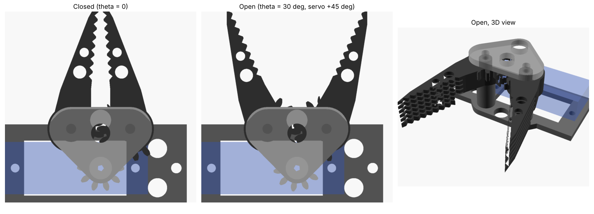
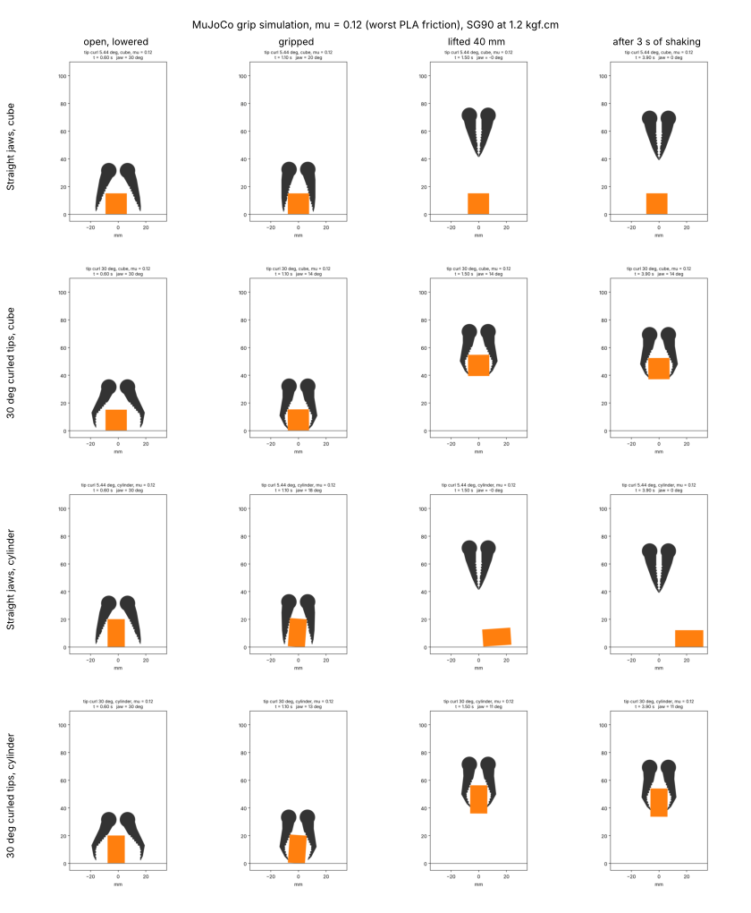
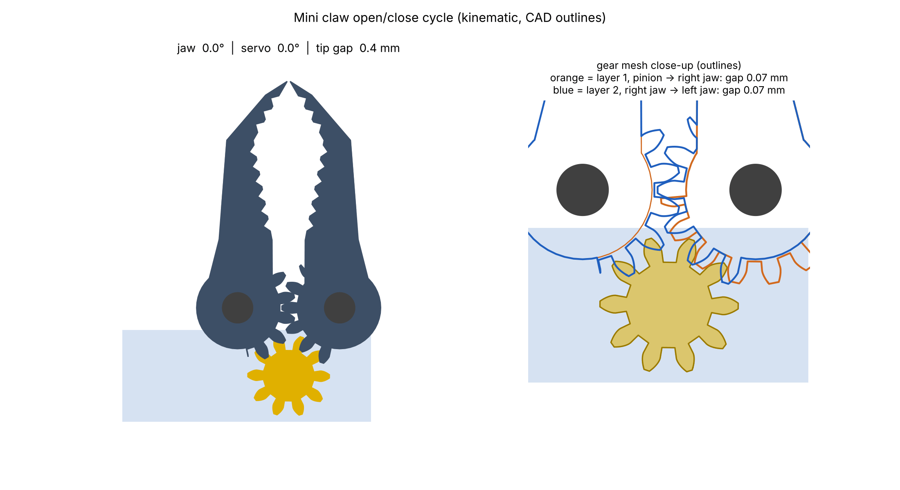
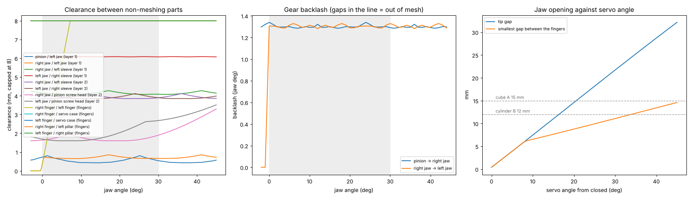

# Mini geared claw (gripper concept C6)

A small 3D-printed angular gripper for the SG90. It works like the Kitronik Klaw (the jaws are geared together), and its style follows the reference metal claw: curved pointed jaws, serrated gripping edges, round lightening holes and "stacked plate" grooves. The **jaw tips curl inward by 30°** so objects can't slide out. It's sized for our 10–20 mm, ≤ 5 g objects. Background and the other concepts are in [`09_report/engineering_cycle/02_research_gripper.md`](../../09_report/engineering_cycle/02_research_gripper.md).



> **Status: design and simulation only, not printed or tested.** Values marked MEASURE in `mini_claw.scad` are estimates for the SG90 and must be checked on our servo first.
> **AI disclosure (C12):** model, simulation, checks and this README were drafted with AI assistance (Claude). The group must check and understand them before using them as evidence. Simulation results are not physical test results.

## How it works

```
servo ──► pinion (10 T, layer 1) ──► right jaw gear (layer 1)
                                      right jaw gear (layer 2) ──► left jaw gear (layer 2)
```

- The **pinion** sits on the servo spline. It keeps the **original GripperGear's spline hub** (copied from the baseline STL), so it fits the SG90 the same way. Only the teeth are new: involute, module 0.9.
- The jaw gears sit on **two layers**. The pinion only meshes with the right jaw in the lower layer. The two jaws mesh with each other in the upper layer. This keeps the **grip centre on the servo shaft line**, as on the original gripper. With a single layer the servo would have to sit about 7 mm off-centre, which would shift the grip sideways.
- The jaws turn on **M2 screws** inside printed sleeves. The sleeves stand up from the bottom plate and also hold the top plate.
- The bottom plate contains the **original FrontPlate's 43 × 20 mm footprint, servo window (23.4 × 12.6 mm) and screw holes (27.5 mm apart)**, so the servo mounts exactly as before.
- Each jaw's gripping edge has a **straight part** and a **curled end** (the last 9 mm, bent 30° inward), both serrated. Settings `tip_curl` and `curl_len`.

## Why the tips are curled

On an angular claw, the straight gripping edges spread apart towards the tips whenever the jaws are open enough to hold something. When they close on a cube, they touch only its **top corners**. Squeezing then pushes the object **out through the tips**, and squeezing harder doesn't help: the outward push and the friction both scale with the squeeze. Curling the tips inward makes them catch the **bottom** of the object as well, so it's trapped instead of held by friction alone. The simulation below shows this happening.

## Key numbers

| | Value |
| --- | --- |
| Gear ratio | 1.5 : 1 (servo turns 1.5° per jaw degree) |
| Servo travel used | ≈ 45° for fully closed → fully open |
| Tip travel | ≈ 0.36 mm per servo degree, per jaw |
| Grip force per jaw at SG90 stall | ≈ 3.0–4.4 N at the tips (F = 0.75 T / L, before gear friction) |
| Grip force needed (worst case) | ≈ 1.6 N per jaw (research doc, section 3) |
| Gripping face height | 9 mm (6 mm gear stack + 3 mm extra finger depth) |
| Overall size | ≈ 43 × 49 × 21 mm without servo |

**Gap against jaw angle** (30° curl), from the model geometry:

| Jaw angle θ | Servo change | Tip gap | Gap at the bend | Gap at edge start |
| --- | --- | --- | --- | --- |
| 0° | 0° | 0.4 mm | 9.4 mm | 4.4 mm |
| 10° | 15° | 11.0 mm | 17.2 mm | 7.7 mm |
| 14° | 21° | 15.3 mm | 20.3 mm | 9.0 mm |
| 20° | 30° | 21.7 mm | 24.8 mm | 11.1 mm |
| 30° | 45° | 32.2 mm | 32.2 mm | 14.6 mm |

In the simulation the 15 mm cube is held at θ ≈ 14° (servo ≈ 21° from closed) and the 12 mm cylinder at θ ≈ 13–14°, with the tips under the object.

## Mass

Volumes from the exported STLs, as if printed **100 % solid** (PLA 1.24 g/cm³). The original is measured the same way, so the comparison is fair.

| Part | Mini claw | | Original gripper parts | |
| --- | --- | --- | --- | --- |
| Pinion | 0.14 cm³ | 0.17 g | Gear 0.14 cm³ | 0.17 g |
| Jaws ×2 | 2.37 cm³ | 2.94 g | Jaws ×2 4.14 cm³ | 5.13 g |
| Bottom plate (+ sleeves) | 1.86 cm³ | 2.31 g | FrontPlate 1.12 cm³ | 1.39 g |
| Top plate | 0.49 cm³ | 0.61 g | Racks ×2 0.94 cm³ | 1.17 g |
| **Total plastic** | **4.86 cm³** | **6.0 g** | **6.34 cm³** | **7.9 g** |
| Screws | 2 × M2 ≈ 0.9 g | | — | |

It's about **1.9 g lighter in plastic** (23 %), or about 1 g lighter once the steel screws are included. Thin parts like these are mostly outer walls, so **infill makes little difference**. The saving comes from the shape. Weigh both printed sets to confirm.

---

## Checks

### 1. Moving parts don't collide (OpenSCAD)

The `check_*` parts intersect the moving parts in 2D at a given jaw angle. An empty result means no overlap. They were run **every 2.5° from 0° to 30° (65 checks), all clear**:

| Check | Result |
| --- | --- |
| Pinion vs right jaw gear (layer 1) | No overlap at any angle |
| Pinion vs left jaw (layer 1) | No overlap |
| Right vs left jaw, layer 1 | No overlap |
| Right vs left jaw gears, layer 2 | No overlap |
| Lowered finger section vs bottom plate and servo | No overlap |

To make sure the checks can fail, they were also run with deliberate errors: tips overlapping, the pinion turned tooth-on-tooth, and negative backlash. Each was correctly reported as an **overlap**.

```bash
openscad -D 'part="check_l2_jaws"' -D theta=20 -o check.dxf mini_claw.scad
```

"Current top level object is empty" means the check passed.

### 2. Grip simulation (MuJoCo physics)

[`sim/grip_sim.py`](sim/grip_sim.py) runs a full pick cycle in the [MuJoCo](https://mujoco.org) physics engine with the claw pointing down:

1. open, lower over the object until the tips are 1.5 mm above the table
2. close (the servo pushes up to its stall torque)
3. lift 40 mm
4. shake ±8 mm at 4 Hz in the jaw plane (≈ 0.5 g), then across it, then up and down
5. put down and open

The jaw contact shape comes from the CAD gripping edge for each curl angle. The objects are the Stage 1 test objects at the 5 g limit: **A** = 15 mm cube, **B** = 12 mm × 20 mm cylinder. Friction is swept over the measured PLA range (μ = 0.12–0.38, research doc source 7). Each case gets **5 trials** with the object shifted −1.5 to +1.5 mm across the jaws. The cube also gets 4 more trials rotated 2–8° on the table.



**Results, object shifted across the jaws** ("secure" = held, with < 2 mm slip in the jaws). Full table: [`sim/results/summary.md`](sim/results/summary.md).

| Tip curl | Cube μ 0.12 / 0.25 / 0.38 held | Cylinder μ 0.12 / 0.25 / 0.38 held | Cylinder slip once held |
| --- | --- | --- | --- |
| Straight (first version) | 0/5 · 1/5 · 5/5 | 0/5 · 2/5 · 5/5 | — |
| 12° | 5/5 · 5/5 · 5/5 (slips ≈ 6 mm) | 5/5 · 1/5 · 5/5 | ≈ 0.1–12 mm |
| 18° | 5/5 · 5/5 · 4/5 (slips ≈ 3 mm) | 5/5 · 5/5 · 5/5 | ≈ 5–7 mm |
| 24° | **5/5 · 5/5 · 5/5**, slip < 0.3 mm | **5/5 · 5/5 · 5/5** | ≈ 4–5 mm |
| **30° (chosen)** | **5/5 · 5/5 · 5/5**, median slip < 0.1 mm (one trial at μ 0.38 settled 3.5 mm) | **5/5 · 5/5 · 5/5** | ≈ 2–4 mm |

**Cube rotated on the table** (secure at 0 / 2 / 4 / 6 / 8°):

| Tip curl | μ 0.12 | μ 0.25 | μ 0.38 |
| --- | --- | --- | --- |
| Straight | ✗ ✗ ✗ ✗ ✗ | ✗ ✗ ✗ ✗ ✗ | ✓ ✗ ✗ ✗ ✗ |
| 18° | ✗ ✗ ✗ ✗ ✗ | ✗ ✗ ✗ ✗ ✗ | ✗ ✗ ✗ ✗ ✗ |
| 24° | ✓ ✓ ✗ ✓ ✓ | ✓ ✓ ✓ ✓ ✓ | ✓ ✓ ✓ ✓ ✓ |
| **30°** | ✓ ✓ ✓ ✓ ✓ | ✓ ✓ ✓ ✓ ✓ | ✓ ✓ ✓ ✓ ✓ |

**What it shows:**

- **Straight jaws drop both objects** unless friction is at the top of the PLA range, which confirms the squeeze-out problem.
- **A 30° curl holds both objects in every trial**, through lift and all three shakes, at every friction value and with the cube rotated up to 8°.
- The cylinder slides 2–4 mm down into the curled tips as it's lifted, then stays there. That settling is expected and isn't a slip during the shaking.
- **Every object was released cleanly** when the claw opened.
- The jaw gear coupling stayed within 0.004° throughout. The mismatch between the two jaws is logged, to check the model is doing what real gears do.

**Limits of the simulation (say these in the report):**

- Gears are modelled as a perfect 1 : 1 link with no backlash.
- The servo is an ideal position controller limited to 1.2 kgf·cm stall.
- Jaw contact uses the CAD gripping edge as solid blocks. The serration teeth are represented only through the friction sweep.
- Contact is MuJoCo's soft-contact model with stiff settings (at most 0.07 mm penetration for the cube, 0.17 mm for the cylinder), not measured PLA behaviour.
- The objects are rigid and sharp-edged.

**It is evidence for choosing the design, not a replacement for the 5 physical trials per object that the brief requires.**

```bash
pip install mujoco "shapely>=2.1" ezdxf matplotlib
python3 -I sim/grip_sim.py --gif          # full run, ~10 min
python3 -I sim/grip_sim.py --quick        # one trial per curl, ~10 s
```

### 3. Open/close mechanism simulation (kinematic)

[`sim/mechanism_sim.py`](sim/mechanism_sim.py) moves the real CAD outlines of every part through the stroke, from −3° (driven past closed) to 45° (well past fully open), in 0.25° steps: 193 poses and 2,895 pair checks. At each step the pinion turns 1.5× the jaw angle and the jaws mirror each other. It checks every pair of parts that share a height band (gear layer 1, gear layer 2, the lowered fingers). It also measures gear backlash by holding each driving gear still and turning the driven gear until its teeth touch. Full report: [`sim/results/mechanism_report.md`](sim/results/mechanism_report.md).





| Check | Result |
| --- | --- |
| Any parts overlapping, 0–30° | **None** |
| Gear mesh gap (both meshes) | 0.07 mm at every angle: the teeth roll without binding |
| Tightest other clearance | 0.40 mm (jaw tips at fully closed, by design). Next: pinion to left jaw hub 0.43 mm at 14.5° |
| Gear sectors in mesh | Yes, over the whole sweep up to 44°, so they can't jump teeth inside the range |
| End-stop when closing | Jaw tips touch at −0.5°, so the closed limit is the tips themselves |
| End-stop when opening | Nothing touches up to 45°. Only the servo limit stops it, so set the firmware limit. |
| Mesh centring (phase error) | 0.016°, so the teeth are correctly phased |
| Stroke time at SG90 speed | ≈ 75 ms closed → open. Tips move at ≈ 214 mm/s, which is a pinch hazard, so use a low `SPEED` |

**Finding: free play.**

- **Each gear mesh has 1.3° of backlash** (from the 0.15 mm `backlash` setting). The ≈ 31 mm jaws magnify it to about **0.7 mm at the right tip**.
- **The left tip gets about 1.4 mm**, because its play passes through both meshes.
- That's **≈ 2.1 mm of play in the tip gap**, plus up to 0.25 mm from each pivot hole.

The play disappears once the jaws are squeezing an object, because the load holds the teeth against one flank. So it affects **where an open or empty claw sits**, not grip. Play scales directly with `backlash`: 0.08 mm would roughly halve it. Use the smallest value that still turns freely in the printed fit test (see MEASURE, step 4).

```bash
python3 -I sim/mechanism_sim.py     # ~30 s, writes sim/results/mechanism_*
```

### 4. Gear tooth strength (hand calculation)

The Lewis bending formula gives the stress at the root of a tooth: σ = F_t / (b · m · Y). Here F_t is the force at the pitch circle, b the face width (3 mm), m the module (0.9 mm) and Y the Lewis form factor (10 teeth 0.201, 15 teeth ≈ 0.29 [Shigley, via EES](https://fchartsoftware.com/ees/mechanical_design/gear%20design/hs103.htm); [gearpy table](https://gearpy.readthedocs.io/en/latest/mechanical_objects/HelicalGear/lewis_factor.html)). The servo is assumed to be stalled.

| Mesh | Force at stall, 1.2 / 1.8 kgf·cm | Tooth root stress |
| --- | --- | --- |
| **Pinion (10 T)** | 26 / 39 N | **48 / 72 MPa** |
| Right jaw gear against the pinion (15 T) | 26 / 39 N | 33 / 50 MPa |
| Jaw against jaw (15 T) | 13 / 20 N | 17 / 25 MPa |

Printed PLA reaches about **48–55 MPa** in its strongest direction ([MDPI 2025](https://www.mdpi.com/2073-4360/17/14/1934); [Springer 2020](https://link.springer.com/doi/10.1007/s00170-020-06138-4)). Teeth printed flat are loaded in that strong direction.

**Finding:** at full stall the **pinion is at or past the strength of PLA**. The original supplied gear has the same tooth size, count and thickness, so it shares this risk. Lewis is conservative: it ignores two teeth sharing the load and assumes the force acts at the tooth tip. Even so:

1. **Don't hold the gripper at stall.** Close to a set angle a few degrees past contact (concept C5). The simulation holds both objects at 13–14° jaw angle, so the firmware never needs to command fully closed.
2. If a pinion breaks in testing, raise `layer` from 3 to 4.5 mm. That cuts the stress by a third and also makes the grip face deeper.

---

## Other software that can simulate it

| Software | Cost for students | What it can check |
| --- | --- | --- |
| **Autodesk Fusion** | Free education licence | Joints and **motion study** (animate the gear train), **contact sets** that stop parts passing through each other, interference check, and **Simulation** (FEA) for tooth and sleeve stress |
| **SolidWorks** (if the uni has it) | University licence | **Interference detection** over a motion range, **Motion Analysis** with contact and gear mates, SimulationXpress or Simulation for stress |
| **Onshape** | Free education plan | Gear relations and animated mates, to see the motion in a browser |
| **FreeCAD** | Free, open source | Gears workbench (involute gears), Assembly workbench to animate, **FEM** workbench for stress |
| **MuJoCo** / PyBullet / Gazebo | Free, open source | **Physics**: gripping, slip, drops and shaking with real masses and friction. This is what `sim/grip_sim.py` uses. |

**What each type answers.** CAD motion and interference checks answer "do the parts collide?" (done here in OpenSCAD, and over the full stroke in `mechanism_sim.py`). Physics simulators answer "does it hold the object?" (done here in MuJoCo). FEA answers "will a tooth or sleeve break?" (estimated here by hand with Lewis; a Fusion or FreeCAD FEA would firm it up).

---

## Before printing: MEASURE

1. **Servo heights:** tab thickness (2.5 mm assumed) and tab top to spline top (10.5 mm assumed). These set how high the gear stack sits. If the spline is lower or higher, change `tab_top_to_spline_top`.
2. **Shaft position** in the window: the shaft centre to the near window end (5.9 mm assumed).
3. **How the original FrontPlate attaches to ArmFront.** The new bottom plate keeps FrontPlate's footprint, but anything outside that footprint must not hit the arm.
4. **Gear fit on our printer.** Print the pinion and one jaw, then turn them by hand. If they bind, raise `backlash` (0.15 mm now). If they rattle, lower it. Printer clearances differ (research doc, source 16).

## Printing

| Part | Orientation | Notes |
| --- | --- | --- |
| `mini_claw_jaw_right.stl`, `mini_claw_jaw_left.stl` | Flat top face down | No supports. Grooves are 0.5 mm deep and bridge fine. 0.12–0.16 mm layers for clean teeth. |
| `mini_claw_pinion.stl` | Spline recess up | Same as the original gear |
| `mini_claw_bottom_plate.stl` | Plate down, sleeves up | Sleeves are thin (2 mm radius): print slowly or use 100 % infill for them |
| `mini_claw_top_plate.stl` | Flat | |

4 perimeters, so the teeth and sleeves come out solid. Infill 15–20 % (it barely matters at these thicknesses).

## Parts list

- Printed: pinion, right jaw, left jaw, bottom plate, top plate
- 2 × M2 × 20 screws as the jaw pivots (into the sleeves). Self-tapping, or use a 1.75 mm filament pin instead.
- The SG90 and its mounting screws and horn screw (already in the kit)

## Assembly

1. Fit the servo through the bottom plate window, the same way it goes on FrontPlate.
2. **Set the servo angle first.** Send the gripper to its "closed" angle (e.g. `S GRIP 30`) with the servo connected but nothing fitted.
3. Press the pinion onto the spline and fit the horn screw.
4. Put both jaws on their sleeves **closed** (tips touching). Mesh the left jaw with the right jaw first, then turn the pinion gently until the right jaw meshes with it.
5. Fit the top plate and the two M2 screws. Snug them, not tight, so the jaws turn freely (as on the Klaw).
6. Open in small steps from the GUI (`S GRIP 35`, `40`, …) and check nothing rubs.

## Firmware changes needed

- **The gripper range shrinks to about 45°** of servo travel. Set `GRIP lo/hi/home` in the firmware calibration block from the measured closed and open angles. The current 30–150° would drive it past its stops.
- **Grip to an angle, not fully closed** (concept C5, and the tooth-strength finding). In the simulation both objects were held at about 14° jaw angle, which is about 21° of servo travel from closed. Command a few degrees past the measured contact angle.
- **Pick from just above the table:** lower until the tips are 1–2 mm above the surface before closing, so the curled tips get under the object, as in the simulation.
- **Update `L3`** (wrist pivot to gripper tip). The new tip position depends on how the plate attaches, so measure it once assembled.

## Trade-offs (for the decision matrix)

| For | Against |
| --- | --- |
| Lighter (≈ 23 % less plastic) | All new parts: 5 prints and 2 screws, against 2 jaw reprints for C2 |
| Opens wider (≈ 32 mm at the tips vs ≈ 19 mm change) | Jaws swing in an arc, so grip point and contact angle change with object size |
| Curled tips trap the object: held in every simulated trial | Pointed, curled tips are a pinch point (risk register) |
| Gear reduction gives finer control and more force | Pinion teeth near PLA's limit at stall, so grip to an angle |
| Every part prints flat with no supports | Small printed teeth (module 0.9) need a well-tuned printer, and the servo heights are estimates until measured |
