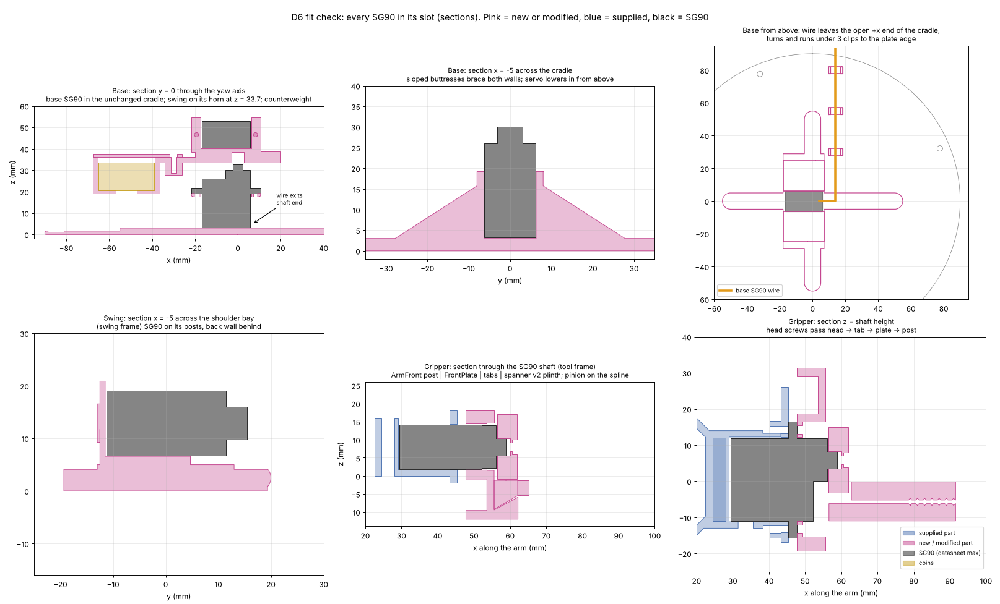
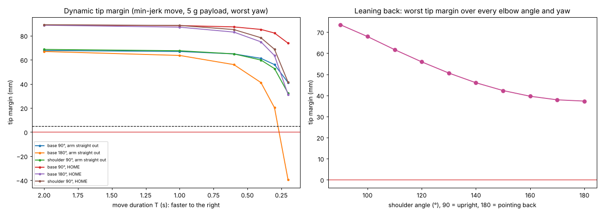
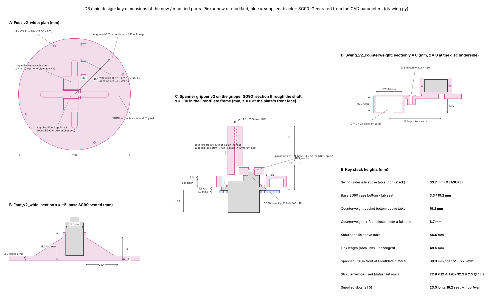

# Main design (confirmed 26 Nov 2026): D6, spanner gripper + swing counterweight + wide base

> **Status: confirmed as the build design after a full check against the brief and the group's objectives (below). Designed and checked in CAD and simulation; not printed or built yet.** These results come from the design stage. They are not measured evidence for `08_tests/`. Dry-fit the first prints before relying on them.
> **AI disclosure:** the wide base, spanner v2, these checks and this README were produced with AI assistance (Claude Code). The group must check and understand them before using them in the report.

The group chose to build the **spanner gripper with the swing counterweight**. D6 is that build, plus:

1. **Wide base** (`../wide_base/`, `Foot_v2_wide.stl`). The supplied foot stays intact inside a Ø180 × 1.6 mm plate, with sloped buttresses on the servo cradle, a wire lane and engraved pick/place targets. It removes the counterweight's one weak point (tipping backward when the shoulder leans back).
2. **Spanner gripper v2** (`../spanner_gripper/`, `GripperSpanner*_v2.stl`). Same mechanism as v1, but it now fits the real SG90 stack (see below). **v1 does not fit and must not be printed.**

## Objectives check (26 Nov 2026)

Every objective that applies to the mechanical design, from the brief (CT6056 case study), the spanner gripper's requirements (`../spanner_gripper/README.md` §8) and the group's own goals. **Design** = met by the CAD / simulation. **Build** = the design is ready, and the evidence comes from the physical tests the brief asks for.

| # | Objective (source) | Result | Evidence |
| --- | --- | --- | --- |
| G1 | Wider, more stable base (group) | **Met.** Tipping edge ~39 → ~90 mm; stable in 100 % of collision-free poses, front and back; worst margin +37 mm | `simulate_build.py`, D6 STAB |
| G2 | Spanner gripper + counterweight is the build (group) | **Met.** D6 = spanner v2 + `Swing_v2_counterweight` + `Foot_v2_wide` | this folder |
| G3 | All servos fit; size taken from the supplied slots (group) | **Met.** 5/5 SG90s, 0.00 mm overlap; model checked against all 5 slots and 2 datasheets | `fit_check.py` FIT |
| G4 | Assembled step by step by hand (group) | **Met.** 10 moves, 8 screw accesses clear; lid reachable with the arm fitted | `fit_check.py` ASSY |
| G5 | Room for the wires (group) | **Met.** No new material in any wire path; base wire lane under 3 clips; swing ≥ 12 mm above it; counterweight 45 mm from the arm bundle | `fit_check.py` WIRE |
| G6 | Uses the supplied servo horns and screws (group) | **Met.** Horns under the swing and on the fork outer faces as supplied; supplied tab screws fix the spanner head (counterbored) | spanner README §4 |
| B1 | Build on the supplied resources; keep them traceable (brief, files) | **Met.** Supplied parts untouched in `00_baseline/`; Foot and Swing keep 0.00 mm³ of original material removed; links, ArmFront, FrontPlate unchanged | ASM-3, ASM-5 |
| B2 | Assemble progressively, check free movement and self-collision at every joint (Task 2.6) | **Design: met.** Range test of every joint from HOME; 34,447-pose collision sweep | D6 video, `full_designs` COL |
| B3 | Cables: bend radius, strain relief, full range without pulling a connector (Task 2.7) | **Design: met.** The base wire doesn't twist (the base servo is static) and is held in a lane. The arm bundle turns with the swing. Leave a ~60 mm slack loop for ±90°. **Build:** check after routing | `fit_check.py` WIRE |
| B4 | Material and print strategy: orientation, supports, print time (Task 2.3) | **Met.** All new parts are watertight and print without supports except the counterweight pocket (documented). Min wall 0.85 mm at the head's screw seat, ≥ 1 mm elsewhere (gear teeth, grip serrations and the tip of the 30° dovetail lip excepted). ~106 cm³ printed | printability check, part READMEs |
| B5 | Move smoothly inside a defined safe workspace (challenge, Task 8) | **Design: met.** Workspace defined: floor rule (1.6 mm plate, 0 outside), joint limits, no tipping anywhere, quasi-static tipping only at moves faster than the servos can go | `simulate_build.py` |
| B6 | Operate the gripper; repeatable pick-and-place of a lightweight object (challenge) | **Design: met.** 10/10 simulated tasks pass (cube + cylinder, 60–100 mm, up to ±90°). **Build:** repeated physical runs (TASK-01) | `simulate_build.py` TASK |
| B7 | Servo loads within limits (Tasks 3, 4) | **Met.** Peak static 39 / 22 / 10 % of stall; base 13 % for 90° in 0.6 s | D6 TRQ, YAW |
| B8 | Kinematic model: link lengths, frames, tool offset (Task 7) | **Met.** Links unchanged (49.5 mm); shoulder axis 46.6 mm above the table; TCP 39.3 mm out, offset `gap/2 − 6.75` mm sideways | drawing E, spanner §7 |
| B9 | Gripper: evaluate the original, ≥ 2 concepts, justified selection (Task 10.3–10.4) | **Met.** Original evaluated; spanner concepts A/B/C + mini claw compared; selection justified and confirmed by simulation | spanner README §2–3, `full_designs` |
| B10 | Dimensioned CAD; check clearances, gear/rack mesh, wall thickness, servo travel, symmetry, slicer warnings (Task 10.5) | **Met.** Key-dimension sheet; mechanism sim 12/12 (mesh, backlash 0.23 mm, contact ratio 1.74, stresses); 140° of the SG90's 180°; asymmetry is by design (datum jaw) with the offset documented; new STLs watertight (repair the 3 supplied ones) | `results/key_dimensions.png`, `../spanner_gripper/sim/` |
| B11 | Two test objects of different width/shape within range (Task 10.1) | **Met.** 15 mm cube and 12 × 20 mm cylinder inside the 1.0–20.5 mm opening; larger objects via the tooth preset | spanner §6 |
| GRIP-01 | Opening ≥ 18 mm | **Design: met.** 19.5 mm range (1.0–20.5) | spanner sim |
| GRIP-02 | Jaw faces parallel within 0.5 mm | **Design: met.** Dovetail lift play 0.38 mm, side play 0.20 mm | spanner sim |
| GRIP-03 | Backlash at the jaw ≤ 0.5 mm | **Design: met.** 0.23 mm | spanner sim |
| GRIP-04/05 | 5/5 transfers per object; datum placement ±1 mm | **Build:** physical trials (`08_tests/gripper_trials.csv`) | – |
| SAFE | Pinch points, servo stall | **Design: met.** Torque margin ≥ 2.5×; grip by commanded gap (object − 1 mm), not stall; floor rule for firmware | spanner §7, this README |

**Decision:** D6 meets every design objective. The rest is build-stage evidence the brief asks for anyway: dry-fit, cable routing, calibration, and the repeated gripper and pick-and-place trials. **D6 is confirmed as the design the group builds.**

### Confirmation checklist (fit, assembly, wiring)

| Question | Answer | Evidence |
| --- | --- | --- |
| Do all 5 SG90s fit their slots? | **Yes.** 0.00 mm overlap with every part. The only contact is the designed 0.03 mm press fit of the pinion on the spline | `fit_check.py` → FIT, `results/fit_sections.png` |
| Can it be assembled step by step by hand? | **Yes.** All 10 assembly moves and all 8 screws are clear. The counterweight lid screw can be reached with the whole arm fitted | `fit_check.py` → ASSY, order below |
| Is there room for the wires? | **Yes.** No new material is in any servo's wire path. The base wire has its own lane under 3 clips, and the swing passes ≥ 12 mm above it. The counterweight stays 45 mm from the arm's wire bundle | `fit_check.py` → WIRE |
| Is the original geometry kept? | **Yes.** Foot and Swing: 0.00 mm³ of the supplied parts removed. Links, ArmFront and FrontPlate are unchanged | `full_designs` ASM-3, ASM-5 |
| Does it tip? | **No.** Stable in 100 % of collision-free poses, front and back. Worst margin +37 mm (arm pointing straight back) | `simulate_build.py`, `full_designs` D6 |
| Can the servos hold it? | **Yes.** Peak static load 39 / 22 / 10 % of stall (shoulder / elbow / wrist) | `full_designs` D6 TRQ |
| Does pick-and-place work? | **Yes.** All 10 tasks pass (cube and cylinder, 60–100 mm, up to ±90°) | `simulate_build.py` TASK |

**What still has to be measured on the real build** (the CAD can't settle these):

1. The **swing height** above the table (model: 33.7 mm, set by the base servo + horn stack).
2. **`boss_top`** on the gripper servo. This is the height of the boss top above the FrontPlate front face (model: 10.8 mm). If it differs, regenerate spanner v2: everything moves with it.
3. The **spline press fit** of the printed pinion. Print it first and test it on a servo.
4. **Plate flatness** of the printed foot, and the **real masses** of all parts.

## How the servos were sized

The servo dimensions come from the **slots in the supplied STLs** (which the SG90s are known to fit, see the photos of the original build), checked against two SG90 datasheets:

| Slot (supplied part) | Slot length | Tab seat → floor / back wall | Shaft |
| --- | --- | --- | --- |
| Foot cradle | 23.5 mm | 16.2 mm (tabs on the cradle top at z 19.2, floor z 3.0) | yaw axis |
| Swing bay | 23.5 mm | 16.2 mm (posts y 4.7, back wall y −11.5) | shoulder axis |
| ArmSpring / Arm bays | 23.5 mm | 16.2 mm (same) | 49.5 mm pivot |
| ArmFront bay + FrontPlate window | 23.5 × 12.6 mm window | case through the plate, **tabs on the plate's front face**, case bottom 0.4 mm from the bay wall | arm axis |

| SG90 (datasheet maximum used) | Value |
| --- | --- |
| Case | 22.8 × 12.4 mm (Luxorparts 87897); TowerPro 22.2 × 11.8 |
| Tabs | 32.2 mm long, 2.5 mm thick, underside 15.6–16 mm above the case bottom (model 15.9) |
| Boss / spline / horn top | 26.7 / ~29.4 / ~31 mm above the case bottom |
| Wire | leaves the case at the **shaft end**, 1–5 mm above the bottom (as in the photos) |

The model is validated against the supplied parts. Each servo placed this way overlaps nothing in the supplied parts. The checker catches a servo moved just 1 mm into its slot (self-test).

Two things this changed compared with earlier versions:

- **The spanner v1 head sat where the servo tabs are**, and its pinion was ~8 mm below the spline. **v2** lifts the mechanism 8.3 mm onto the spline. It stands on a hollow plinth that rests on the tabs, with the case and boss passing through its window. Its counterbored screws let the **supplied SG90 tab screws** reach the ArmFront posts.
- **The swing sits higher** than first assumed: 33.7 mm, set by the base servo and horn stack, instead of 27.2 mm. The counterweight now clears the foot by **8.7 mm**, not 2.6 mm. All results below use the corrected height.



## Hand-assembly order (all steps checked)

| # | Step | Direction | Check |
| --- | --- | --- | --- |
| 1 | Base SG90 into the `Foot_v2_wide` cradle | lowered in from above | clear |
| 2 | Base tab screws (supplied), 2× | screwdriver from above | clear |
| – | Push the base wire out of the open +x end of the cradle and under the 3 clips. Leave a little slack before the first clip | – | lane clear |
| 3 | Fit a horn (supplied) under the swing disc. Set the base servo to neutral and lower `Swing_v2_counterweight` onto the spline, arm direction on the FRONT arrow | lowered from above | clear; 8.7 mm to the foot over a full turn |
| 4 | Shoulder SG90 into the swing bay, then its 2 tab screws | lowered in from above; screws along the shaft | clear |
| 5 | 7 × 2p coins (felt shim) into the pocket, lid on, M3 lid screw | from above | clear, and still reachable with the whole arm fitted |
| – | ArmSpring, elbow SG90, Arm, wrist SG90, ArmFront as in the supplied build (horns on the forks' outer faces) | – | supplied parts, unchanged |
| 6 | Gripper SG90 through the FrontPlate window into the ArmFront bay, case first | pushed in | clear |
| 7 | `GripperSpannerHead_v2` over the case onto the tabs. 2 supplied tab screws down the counterbores (head → tab → plate → post) | pushed on; screws along the shaft | clear |
| 8 | `GripperSpannerSlider_v2` into the dovetail from the open end | slid in | clear |
| 9 | Servo to CLOSED. Press `GripperSpannerPinion_v2` onto the spline (1 mm jaw gap), then fit the horn screw | pressed on | press fit 0.03 mm |
| 10 | `GripperSpannerJaw_v2` onto the slider tenon, then its M2 × 8 screw | pushed on | clear |

**Wiring.** Every servo's wire leaves the case at the shaft end. On the arm links, swing and ArmFront it bends round the same lips as in the supplied build: no new part is in the way. Gather the shoulder, elbow, wrist and gripper wires along the links and let them drop off the swing's **+x (front) end** in a loose loop. That bundle turns with the swing, and the counterweight is always on the opposite side, 45 mm away. The base wire stays flat in its lane, and the lowest swing part passes 12 mm above it.

## Simulated performance (`simulate_build.py`, `../full_designs/` D6)

| | D5 (same arm, supplied foot) | **D6** |
| --- | --- | --- |
| Stable poses, worst yaw: arm in front / reaching back | 100 % / 47 % | **100 % / 100 %** |
| Worst tip margin anywhere in the servo windows | −25 mm (tips) | **+37 mm** |
| Tip margin, arm straight out | +13 mm | **+68 mm** |
| Pick-and-place, 15 mm cube, −45° → +45° | 60, 80, 100 mm | 60, 80, 100 mm |
| Tip margin during those runs | 26–34 mm | **79–85 mm** |
| Shoulder ≤ 110° firmware rule | needed | **not needed** |
| Peak static load, shoulder / elbow / wrist | 39 / 22 / 10 % | 39 / 22 / 10 % |
| Total mass (estimate) | – | 187 g (88 g printed, 99 g servos, coins, screws) |

### Pick-and-place map


The arm goes HOME → 30 mm above → grasp → lift with 5 g → HOME for every object position. Every sample is checked for collisions, plate/table contact, tipping and servo load.

| Object | Passes | Notes |
| --- | --- | --- |
| 15 mm cube | 60, 70, 80, 100 mm at −90° … +75°; 60, 80 mm at +90° | 90 mm: would straddle the plate edge. 50 mm and ≥ 110 mm: no collision-free tool angle (the spanner head is long and bulky) |
| 12 × 20 mm cylinder | 60–80 and 100–130 mm at every yaw | taller, so it is gripped higher |

Peak servo load ≤ 30 % of stall; tip margin ≥ 75 mm everywhere it passes.

**Work-area rule:** put objects at **60–80 mm** (on the plate's engraved Ø17 targets at 60/80 mm, ±45°) or at **~100 mm** on the table. Keep them out of the **83–97 mm** ring (the plate edge).

### Ten pick-and-place tasks: all PASS

Cube: 60 / 80 / 100 mm −45° → +45°; 80 mm −90° → +90°; 60 mm 0° → 100 mm 0°; 100 mm −60° → 60 mm +60°. Cylinder: 60 / 80 / 100 mm −45° → +45°; 80 mm +30° → −60°. Tip margin 75–85 mm, peak load 16–24 %.

### Fast moves, joint limits, leaning back



- **Dynamic tipping:** keeping ≥ 5 mm of margin would need a 90° base move faster than 0.14 s or a 180° move faster than 0.28 s with the arm straight out. The SG90 needs about 0.3 s for 180°, so **the servos can't move fast enough to tip it**.
- **Joint limits from HOME** (base 0°, shoulder 90°, elbow −70°, wrist −80°):

  | Joint | Range | Stops at |
  | --- | --- | --- |
  | Base | full turn (servo gives ±90°) | – |
  | Shoulder | 72° … 180° | head touches the plate |
  | Elbow | −90° … 0° | jaw touches the plate |
  | Wrist | −90° … +90° | servo window |

  The low shoulder and elbow limits depend on the other joints. **Firmware should check the tool height** (TCP z ≥ surface + clearance; surface = 1.6 mm inside r = 89 mm, 0 outside) rather than use a fixed shoulder minimum.
- **Leaning back:** the margin stays positive all the way to the shoulder at 180° (+37 mm).

## Key dimensions



## Parts

The BOM is in `../full_designs/assemblies/D6/D6_bom.csv`. The assembled model at HOME is `D6_assembly_home.3mf`.

| Part | File | Print |
| --- | --- | --- |
| Foot (wide) | `03_cad/stl/Foot_v2_wide.stl` | flat, no supports, brim, ≥ 180 mm bed |
| Swing + counterweight pocket, lid | `03_cad/stl/Swing_v2_counterweight*.stl` | see `../counterweight/README.md` |
| ArmSpring, Arm, ArmFront, FrontPlate | `00_baseline/3d_models/` | supplied; repair the 3 non-closed STLs in the slicer (log in `flaw_log.csv`) |
| Spanner head, slider, jaw, pinion **v2** | `03_cad/stl/GripperSpanner*_v2.stl` | see `../spanner_gripper/README.md` §4. **Not v1** |
| 5 × SG90 with their horns and screws | supplied | horns: base (under the swing), shoulder, elbow, wrist (on the fork outer faces) |
| 7 × UK 2p coins, felt shim, M3 × 10 self-tapper | – | counterweight |
| M2 × 8 self-tapper | – | jaw to slider |

## Firmware and test notes for the other subsystems

- **Floor:** surface 1.6 mm for r < 89 mm, 0 outside. Object centres not at 83–97 mm.
- **Spanner TCP:** 39.3 mm in front of the FrontPlate, offset sideways by `gap/2 − 6.75` mm (`../spanner_gripper/README.md` §7).
- **No shoulder ≤ 110° rule.** Keep the speed limits for smoothness and current, not for tipping.
- **Repeatability (GRIP-05, TASK-01):** use the engraved targets and the rim ticks every 15°.

## Re-run

```bash
pip install numpy scipy trimesh manifold3d python-fcl matplotlib networkx lxml shapely rtree
```

```bash
python3 03_cad/spanner_build/fit_check.py
```

```bash
python3 03_cad/spanner_build/simulate_build.py
```

```bash
python3 03_cad/spanner_build/render_fit.py
```

```bash
python3 03_cad/spanner_build/drawing.py
```

`fit_check.py` takes a few seconds and `simulate_build.py` about a minute. The D6 renders, assembly and video come from `../full_designs/` (`simulate_designs.py --only D6`, `build_assemblies.py`, `animate.py --only D6`).

## Limits

- CAD and simulation only: rigid parts, nominal geometry, datasheet-maximum SG90. Print tolerance, warp, backlash, servo compliance and cable stiffness are not modelled. Dry-fit before final assembly.
- Wires are checked as exit corridors and a lane, not as flexible cables over the whole motion.
- The dynamic check is quasi-static (peak inertial loads).
- The servo horns on the arm forks and under the swing are taken from the supplied design; their exact size comes from the horns you have.
