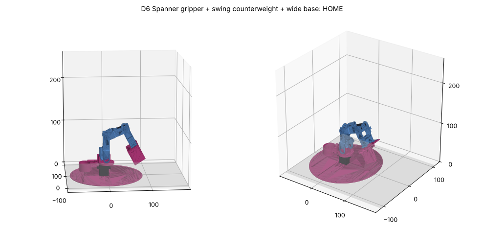
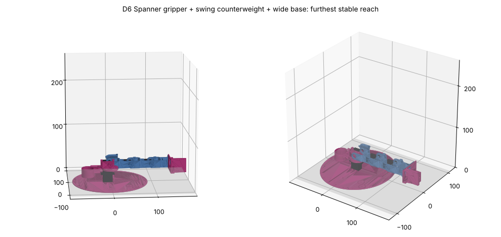
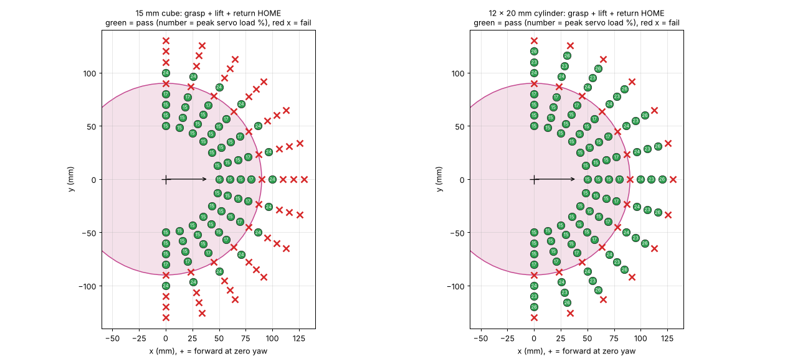

# Chosen build: spanner gripper + swing counterweight + wide base (D6)

> **Status: simulation only.** Nothing here has been printed or built. These results come from the design stage. They are not measured evidence for `08_tests/`. Every value marked **MEASURE** is an assumption to check on the real arm.
> **AI disclosure:** the wide base, these simulations and this README were produced with AI assistance (Claude Code). The group must check and understand them before using them in the report.

The group chose to build the **spanner gripper with the swing counterweight**. This folder takes that build further:

1. **The base is wider** (`../wide_base/`, `Foot_v2_wide.stl`). The supplied foot stays inside a Ø180 × 1.6 mm plate. Gussets brace the servo cradle, and the plate has engraved pick/place targets. This removes the counterweight's one new risk (tipping backward when the shoulder leans back) and gives the build a large stability margin everywhere.
2. **The whole build is simulated in more depth** than the 8-design comparison in `../full_designs/`. That means a pick-and-place map over the whole work area, ten pick-and-place tasks, dynamic tipping during fast moves, joint limits and lean-back stability.

| HOME | Furthest stable reach |
| --- | --- |
|  |  |

Video: [`../full_designs/videos/D6_spanner_gripper_swing_counterweight_wide_base.mp4`](../full_designs/videos/). It shows the range-of-motion limit test, the gripper opening and closing, and pick-and-place of a cube and a cylinder.

## Parts (BOM: `../full_designs/assemblies/D6/D6_bom.csv`)

| Part | File | Status | Print notes |
| --- | --- | --- | --- |
| Foot (wide) | `03_cad/stl/Foot_v2_wide.stl` | **modified** | flat, no supports, brim; needs a ≥ 180 mm bed |
| Swing + counterweight pocket | `03_cad/stl/Swing_v2_counterweight.stl` | **modified** | disc face down, support the pocket |
| Counterweight lid | `03_cad/stl/Swing_v2_counterweight_lid.stl` | new | flat |
| ArmSpring (link 1), Arm (link 2), ArmFront, FrontPlate | `00_baseline/3d_models/` | original | repair the non-closed `Arm`, `ArmSpring`, `ArmFront` in the slicer (supplied-file fault, log it in `flaw_log.csv`) |
| Spanner head, slider, jaw, pinion | `03_cad/stl/GripperSpanner*_v1.stl` | new | see `../spanner_gripper/README.md` §4 |
| 5 × SG90, horns | – | hardware | |
| 7 × UK 2p coins (≈ 50 g) | – | hardware | or any ~50 g filler |
| M2 countersunk ≈ 12 mm × 2, M2 × 8 × 1, M3 self-tapper × 1 (lid) | – | hardware | |
| M3 pan-head × 4 *(optional)* | – | hardware | to screw the base to a board |

Estimated mass: **184 g** in total (85 g printed, 99 g servos/coins/screws), with 129 g of it rotating on the base servo. Print volume is 96 cm³. **MEASURE:** weigh every part, then update `arm_model.py`. The mass model underestimates the foot (shell + 20 % infill, but the 1.6 mm plate prints almost solid: 45 g modelled against ~58 g solid). That makes the stability results conservative.

## Results

### Compared with the same arm on the supplied foot

| | D5: spanner + counterweight, supplied foot | **D6: + wide base** |
| --- | --- | --- |
| Stable poses, worst yaw, all collision-free poses | 83 % | **100 %** |
| Stable poses, arm reaching back over the tail | 49 % | **100 %** |
| Worst tip margin anywhere in the servo windows | −23 mm (tips) | **+39 mm** (shoulder at 180°) |
| Tip margin, arm straight out, worst yaw | +16 mm | **+70 mm** |
| Pick-and-place 15 mm cube (60–160 mm, −45° → +45°) | 60, 80, 100 mm | 60, 80, 100 mm |
| Tip margin during those pick-and-place runs | 26–34 mm | **79–85 mm** |
| Peak static servo load (shoulder / elbow / wrist) | 36 / 20 / 8 % of stall | 36 / 20 / 8 % (unchanged) |
| Base-servo side moment, arm out / HOME | 3.6 / 0.7 kg·mm | 3.6 / 0.7 kg·mm (unchanged) |
| Base torque for a 90° move in 0.6 s | 12 % of stall | 12 % (the foot does not rotate) |
| Firmware shoulder limit needed against tipping | **≤ 110°** | **none** |

The wide base doesn't change anything above the foot: torques, reach, base load and yaw inertia are all the same. It only moves the tipping edge out from ~39 mm (diagonal) to ~90 mm in every direction.

### Pick-and-place map (`results/pick_place_map.png`)



For every object position on a grid (radius 50–130 mm every 10 mm, yaw −90° to +90° every 15°), the arm goes HOME → 30 mm above → grasp → lift with 5 g → HOME. Every one of the 24 samples per leg is checked for collisions, plate/table contact, tipping and servo torque.

| Object | Positions that pass | Radii that pass, at **every** yaw from −90° to +90° | Fails |
| --- | --- | --- | --- |
| 15 mm cube | 65 / 117 | 50, 60, 70, 80, 100 mm | 90 mm: the object would straddle the plate edge. 110 mm and beyond: no collision-free tool angle at grasp height (the spanner head's lower corner reaches the table, as found for D5) |
| 12 × 20 mm cylinder | 91 / 117 | 50–80, 100–120 mm | 90 mm: plate edge. 130 mm: out of reach 30 mm above it |

Peak servo load in every passing run is ≤ 26 % of stall. The minimum tip margin is ≥ 73 mm. Because the plate is round, the result is the same at every yaw.

**Work-area rule for the task and firmware:** put objects at **≤ 80 mm** (on the plate, on the engraved targets) or at **97–105 mm** (on the table, cube) / **97–120 mm** (cylinder). Keep them out of the 83–97 mm ring, where an object would rest on the plate edge.

### Pick-and-place tasks (`results/build_results.json` → `tasks`)

All ten pass, with tip margins of 79–85 mm and a peak servo load of 15–24 %:

| Object | Pick → place | Result |
| --- | --- | --- |
| 15 mm cube | 60 mm −45° → 60 mm +45° | PASS |
| 15 mm cube | 80 mm −45° → 80 mm +45° (the engraved targets) | PASS |
| 15 mm cube | 100 mm −45° → 100 mm +45° | PASS |
| 15 mm cube | 80 mm −90° → 80 mm +90° (180° base swing) | PASS |
| 15 mm cube | 60 mm 0° → 100 mm 0° (off the plate onto the table) | PASS |
| 15 mm cube | 100 mm −60° → 60 mm +60° | PASS |
| 12 × 20 mm cylinder | 60 / 80 / 100 mm −45° → +45°, and 80 mm +30° → −60° | PASS (all 4) |

### Dynamic tipping (`results/dynamics_and_lean_back.png`)


Quasi-static check: a min-jerk move with peak inertial forces applied at every moving part's centre of mass, worst yaw, 5 g payload.

| Move | Static margin | Fastest move that keeps ≥ 5 mm margin |
| --- | --- | --- |
| Base 90°, arm straight out | 70 mm | 0.12 s |
| Base 180°, arm straight out | 70 mm | 0.24 s |
| Shoulder 90°, arm straight out | 70 mm | 0.14 s |
| Base 90° / 180°, HOME | 88 mm | 0.10 s / 0.18 s |
| Shoulder 90°, HOME | 88 mm | 0.16 s |

An SG90 needs about 0.1 s per 60° unloaded, so 0.3 s for 180°. **The servos can't move fast enough to tip this build.** Keep the speed limits for smoothness, backlash and servo current, not for stability. (On the supplied foot, D5 had only 16 mm of static margin to spend on dynamics.)

### Joint limits from HOME (`results/build_results.json` → `limits`)

HOME = base 0°, shoulder 90°, elbow −70°, wrist −80° (tool pointing down, 20 mm+ above the plate).

| Joint | Free range from HOME (others held) | What stops it |
| --- | --- | --- |
| Base | full turn | – (the counterweight clears the foot by 2.6 mm: **MEASURE** the swing height) |
| Shoulder | 71° … 180° | below 71° the spanner head touches the plate |
| Elbow | −92° … 0° | below −92° the jaw touches the plate |
| Wrist | −90° … +90° | end of servo window |

The plate is a floor that the tool can hit, so the low shoulder and elbow limits depend on the other joints. **Firmware should check the tool height (TCP z ≥ surface + clearance, with surface = 1.6 mm inside r = 90 mm) rather than set a fixed shoulder minimum.** With the shoulder ≥ 71° and the tool pointing down, the plate is never hit from HOME.

### Leaning back

The worst tip margin over every elbow angle and yaw stays positive all the way to the shoulder at 180° (arm pointing straight back): it is **+39 mm** there and +62 mm at 110°. The **≤ 110° shoulder rule from `../full_designs/` is not needed with the wide base**. Keep a limit only if the cables or the counterweight lid need one.

## Assembly order

1. Print `Foot_v2_wide`. Check that it lies flat. Fit the base servo in the unchanged cradle.
2. Fit the horn at the base servo's verified neutral, with the arm facing the engraved **FRONT** arrow (+x).
3. `Swing_v2_counterweight` + shoulder servo. Put in the coins with a felt shim and screw on the lid. Turn the swing a full turn by hand and check the clearance to the foot (2.6 mm modelled).
4. Fit ArmSpring, Arm and ArmFront as in the supplied build.
5. Spanner gripper: follow `../spanner_gripper/README.md` §6 (long screws before the pinion, set the pinion at CLOSED, 1 mm gap).
6. Route the cables. Tape the base servo cable across the plate, clear of the targets and the rim ticks.
7. *(Optional)* screw the base to a board through the 4 rim holes.

## Firmware and test notes for the other subsystems

- **Floor:** surface height 1.6 mm for r < 89 mm, 0 mm outside. No object centres at 83–97 mm.
- **TCP offset:** the spanner's grasp centre is off the arm axis by `gap/2 − 6.75` mm (see `../spanner_gripper/README.md` §7). The simulation includes it.
- **Shoulder ≤ 110° rule:** not needed (see above).
- **Repeatability tests (GRIP-05, TASK-01):** use the engraved Ø17 rings at 60 / 80 mm, ±45°. Photograph them against the rim ticks (every 15°).

## Re-run

```bash
pip install numpy scipy trimesh manifold3d python-fcl matplotlib networkx lxml shapely
```

```bash
python3 03_cad/spanner_build/simulate_build.py
```

This takes about 1 minute and writes `results/`. The D6 row of the design comparison, the renders, the assembly and the video come from `../full_designs/` (`simulate_designs.py`, `build_assemblies.py`, `animate.py --only D6`).

## Limits

- Simulation only, rigid parts, nominal geometry. Backlash, servo compliance, print warp and cable drag are not modelled.
- The dynamic check is quasi-static (peak inertial loads), not a full multibody simulation.
- Same **MEASURE** list as `../full_designs/README.md`: swing height above the foot, real masses, servo neutrals. Add one more: **plate flatness after printing**.
