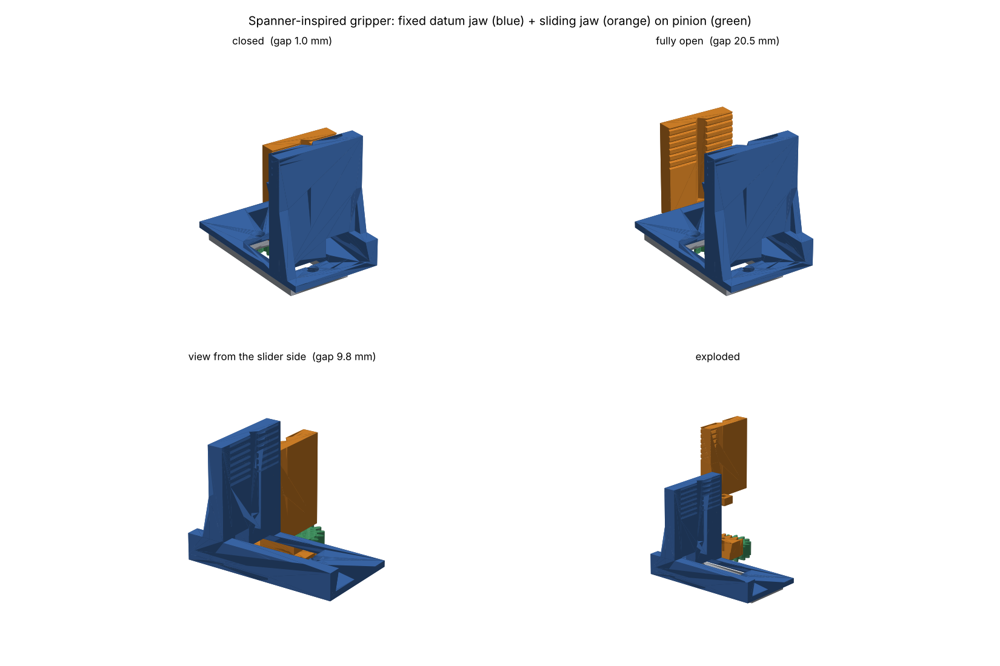
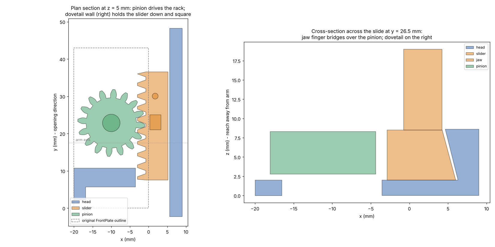

# Spanner-inspired gripper (concept + CAD, v2)

> **v2 (use this): fits the real SG90 stack.** v1 assumed the servo case stuck out only 2.3 mm past the FrontPlate and put the head's base flat on the plate. On the real arm (measured from the supplied `ArmFront` and `FrontPlate` slots and the SG90 datasheets), the case passes **through** the FrontPlate window and the servo **tabs sit on the plate's front face**. Above them: the case top is at 6.8 mm, the round boss reaches 10.8 mm and the spline about 13.5 mm. So the v1 head base sat where the tabs are, and the v1 pinion was ~8 mm below the spline. v1 can't be assembled.
>
> v2 (`GripperSpanner*_v2.stl`, made by `spanner_gripper.py` with no flags) keeps the v1 mechanism exactly and lifts it **8.3 mm**, so the pinion sits on the spline just above the boss. The head stands on a **plinth that rests on the servo tabs**: the case and boss pass through the plinth window, and the plinth is hollowed from underneath with 2.4 mm walls. The two head screws are **counterbored**, so the **supplied SG90 tab screws** (~8 mm) reach through 1.5 mm of head, the 2.5 mm tab and the 2 mm plate into the ArmFront post. You don't need longer screws. Every v2 dimension, assembly step and wire path is checked in `../spanner_build/fit_check.py`. The mechanism sections below (1–3a) are unchanged from v1.


**Status: designed and checked in CAD only. Not yet printed or tested.** Nothing here
is a measured result. The trial tables in `08_tests/` are still empty.




## 1. The idea: what a spanner does well

| Spanner feature | Why it works on a spanner | How this gripper copies it |
| --- | --- | --- |
| **Fixed jaw is part of the handle** | One rigid reference face; only one part moves | The fixed jaw is printed as part of the head. It is a **datum**: one side of the object is always at the same place. |
| **Sliding jaw runs in a guided slot** | The moving jaw cannot twist, so the faces stay parallel | The moving jaw sits on a slider that runs in a **dovetail channel**. The channel holds it down and square. |
| **Worm + rack sets the jaw** | Fine, single-mesh adjustment | **One pinion and one rack.** A worm is not usable because the SG90 only turns about 180°. |
| **Pre-set size, then grip** | You roll the jaw to the nut size, then apply force | **Range presets by re-meshing:** with the servo at its OPEN angle, push the slider in so the gap is right for the object family. One tooth = 3.14 mm of offset. |
| **Parallel flat jaws, multi-flat contact (hex)** | Grips on flats, not corners | Flat parallel faces with a **90° V-groove** along each jaw. Round objects self-centre on 4 lines of contact. Shallow **serrations** near the tips add grip. |

## 2. Compared with the original rack-and-pinion gripper

The original drive is a 10-tooth gear (pitch radius about 4.5 mm, rack pitch 2.96 mm)
between two loose racks. Each rack carries one jaw. Nothing guides the racks apart from
the gear and the front plate.

| Item | Original (from the STLs) | Spanner gripper (from the CAD) |
| --- | --- | --- |
| Moving parts | gear + 2 racks + 2 jaws | pinion + 1 slider/jaw |
| Gear meshes in the backlash chain | 2 | 1 |
| Jaw guidance | none (racks rest on the plate) | 30° dovetail channel, 29 mm slider |
| Jaw reference | both jaws float | fixed datum jaw |
| Opening per servo degree | 2 × 4.5 × π/180 ≈ 0.157 mm/° | 8 × π/180 = **0.140 mm/°** |
| Opening range | ≈ 18.8 mm over 120° | **1.0 – 20.5 mm over 140°** (16.8 mm over 120°), plus presets |
| Ideal grip force at SG90 stall (≈0.18 N·m) | T/(2r) ≈ 20 N | T/r ≈ 22 N |
| Printed volume (100 % solid) | 5.2 cm³ + plate 1.1 cm³ | 14.3 cm³ + the **original plate, kept** |
| Changes to other parts | – | none. Uses 2 longer screws. |

**Costs of this design (state these in the trade-off section):**
- **Heavier:** about 9 cm³ more plastic. At 20 % infill that is roughly 5 g more at the end of the arm. Weigh the printed parts and recheck the arm 2 / swing servo load.
- **Not centred:** the grasp centre is at `y = 10.75 + gap/2` in plate coordinates. The arm axis is at `y = 17.5`. So the tool-centre offset is **`gap/2 − 6.75` mm** sideways. It is zero for a 13.5 mm object and −6.25 mm for a 1 mm gap. Kinematics must add this offset, or place objects against the fixed jaw (datum) side.
- **Wider:** 30 mm across, compared with 23.6 mm for the original jaws.
- **Longer (v2):** the jaw tips are 46.3 mm in front of the FrontPlate (v1: 38 mm), because the mechanism now sits on the real spline. The grasp point (TCP) is 39.3 mm in front of the plate.

## 3. Concepts considered (for the brief's "two concepts and a justified selection")

| | A. Worm-drive spanner (literal copy) | **B. Fixed jaw + pinion-driven sliding jaw (selected)** | C. Original symmetric rack-and-pinion with guides added |
| --- | --- | --- | --- |
| Holding without servo torque | yes (worm does not back-drive) | no (servo holds) | no |
| Works with the 180° SG90 | no: needs a continuous servo and position feedback | yes | yes |
| Speed | very slow | same as the original | same |
| Backlash | low | 1 mesh | 2 meshes |
| Centred grasp | no | no (fixed offset) | yes |
| Parts / complexity | high | 4 printed parts | 5 or more |

B keeps most of the spanner's benefits (datum jaw, guided slide, single mesh, presets) and
works with the supplied servo. C is the fallback if the sideways offset proves hard to
handle in kinematics.

## 3a. Simulation (`simulate.py` → `sim/`)

A rigid-body sweep runs from closed to fully open, 141 steps of 1°. At every step it checks:
- collisions between every pair of parts
- that the pinion is meshed, by turning it both ways until the teeth touch
- backlash
- how far the rack extends past the pinion
- slider lift and side play
- tooth, jaw and joint stresses at SG90 stall

**All 12 checks pass.** See [`sim/simulation_report.md`](sim/simulation_report.md),
`sim/simulation_plots.png` and the animation `sim/spanner_open_close.gif`.

The first run **failed** the slider-capture check. With the original 15° dovetail and
0.3 mm clearance, the slider could lift about 1.1 mm. The dovetail was changed to 30°
with 0.2 mm clearance, which brings lift play down to 0.38 mm. These figures are for rigid
nominal geometry; they are not a substitute for printed trials.

## 4. Parts and bill of materials

| File (`03_cad/stl/`) | Qty | Print orientation | Notes |
| --- | --- | --- | --- |
| `GripperSpannerHead_v2.stl` | 1 | plinth face (the face that sits on the servo tabs) on the bed | no supports (the plinth pockets bridge ≤ 10 mm); 3 perimeters |
| `GripperSpannerSlider_v2.stl` | 1 | bottom face on the bed | teeth stand vertical; 100 % infill |
| `GripperSpannerJaw_v2.stl` | 1 | **jaw face down** (rotate in the slicer) | no supports |
| `GripperSpannerPinion_v2.stl` | 1 | flat | 100 % infill; 0.12 mm layers if you can |
| Original `FrontPlate` | 1 | – | unchanged |
| SG90 tab screws (supplied with the servo) | 2 | – | through the head counterbores, servo tabs and FrontPlate into the ArmFront posts |
| M2 × 8 screw | 1 | – | jaw to slider (self-tapping into a 1.6 mm pilot hole) |
| SG90 horn screw (supplied) | 1 | – | holds the pinion on the spline |

The servo horns supplied with the SG90s are not used on the gripper: the pinion goes straight onto the spline, as the supplied `GripperGear` does. Keep a single-arm horn spare. If the printed spline bore is too loose, trim a horn to its hub and glue it into the pinion's bore instead.

Gear: module 1, 16 teeth, 20° pressure angle, 0.15 mm backlash per side. The CAD sweep
shows about 0.2 mm tip clearance and **zero interference** between any two parts at 6
positions across the full stroke.

## 5. Before printing: measure these on your arm

The script uses a model of the SG90. Measure the real arm and change `P` in
`spanner_gripper.py` if any value is different:

1. **Which end of the window the servo shaft is at.** Default: the shaft is toward the
   high-y end, at `(-10, 22.85)`, 5.35 mm from the window centre. If it is at the other
   end, run `python3 spanner_gripper.py --shaft-low`. This writes a mirrored set named `*_shaftlow.stl`.
2. **`boss_top`:** height of the top of the servo's round boss (where the spline starts) above the FrontPlate's front face, with the servo tabs on the plate (default 10.8 mm, from the datasheet). Measure it with calipers. If it is different, change `boss_top` and regenerate: the whole mechanism moves with it.
3. **`spline_d`:** size of the pinion bore for a press fit on the spline (default 4.7 mm). Print the pinion first as a test.

```
pip install manifold3d trimesh numpy matplotlib
python3 spanner_gripper.py --check   # interference sweep only
python3 spanner_gripper.py           # regenerate the v2 STLs into ../stl/ (--v1 for the old set)
python3 render.py                    # regenerate renders/
python3 simulate.py                  # motion + statics check -> sim/  (~30 s)
```

## 6. Assembly

1. Hold the FrontPlate on the ArmFront end. Push the gripper servo in case-first through the plate window into the ArmFront bay. The tabs end up on the plate's front face, and the wire comes out at the shaft end inside the bay (as in the supplied build).
2. Put the head on (plinth onto the tabs, case through its window). Drive the two supplied tab screws down the counterbores through head, tab and plate into the ArmFront posts. Fit these screws **before** the pinion, because the pinion covers one of them.
3. Slide the slider into the channel from the open (high-y) end, teeth toward the shaft.
4. Command the servo to the calibrated **CLOSED** angle. Press the pinion onto the spline
   so the jaw gap is about 1 mm, then fit the horn screw.
5. Push the jaw's tenon into the slider socket and fit the M2 × 8 screw.
6. Sweep CLOSED to OPEN slowly while watching the servo current. Fix any binding first:
   ease the dovetail with fine sandpaper.

**Range preset (the spanner adjustment):** to work with larger objects, take off the
pinion, move the slider N teeth, and refit the pinion. The opening becomes
`1 + 3.14·N … 20.5 + 3.14·N` mm. Write down which preset was used in every trial.

## 7. Firmware and calibration (agree with the firmware/kinematics owners)

- Gap in mm = `gap_closed + 0.1396 × (θ − θ_closed)`. Calibrate `θ_closed` and the slope
  with a vernier caliper at 3 or more angles, and record them in `04_hardware/calibration_table.csv`.
- To grip, command `gap = object width − 1.0 mm` (a light squeeze), not full closure. This limits stall current and protects the object.
- Lateral tool-centre offset = `gap/2 − 6.75` mm (see section 2).

## 8. Suggested requirements and tests (fill in with measured data)

| ID | Requirement | Method |
| --- | --- | --- |
| GRIP-01 | Opening range of at least 18 mm, measured with calipers | 5 angles, 3 repeats |
| GRIP-02 | Jaw faces parallel within 0.5 mm over 20 mm | feeler gauge at the jaw root and tip |
| GRIP-03 | Backlash at the jaw ≤ 0.5 mm (original: measure) | reverse direction at the same command, use a caliper |
| GRIP-04 | At least 5 of 5 transfers per object, for 2 objects, with no slip or damage | `08_tests/gripper_trials.csv`, original vs spanner |
| GRIP-05 | Same object placement repeatable within ±1 mm using the datum jaw | place, photograph against a grid, 5 trials |

## 9. Known risks and limits

- SG90 position and shaft height are modelled, not measured (see section 5).
- The dovetail clearance is 0.2 mm: tight for FDM. Print the slider first and test it in the head. If it binds, ease it with sandpaper or scale the slider 98 % in x. Rerun the simulation if you change `slide_clear`.
- No mechanical end stops: the firmware limits must keep the slider in the channel.
- If the object or table is hit, the head's fixed jaw takes the load through the two M2 screws. Check the screws after a crash.
