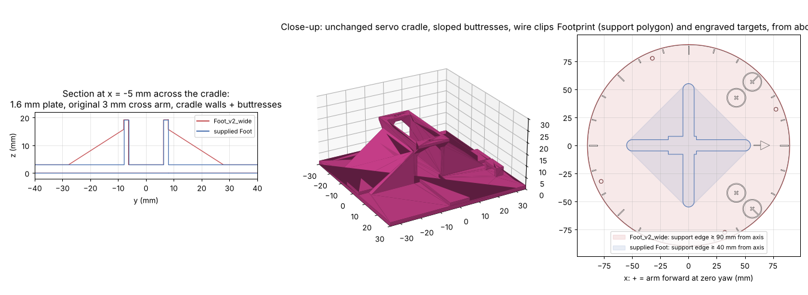

# Wide base (`Foot_v2_wide`) — CAD change proposal

> **Status: designed and checked in CAD and simulation only.** Not printed or tested yet. Nothing here is measured evidence for `08_tests/`.
> **AI disclosure:** the design, scripts and this README were produced with AI assistance (Claude Code). Check them before using them in the report.

**Problem.** The supplied foot is a 110 mm "+" of 8 mm wide arms. Its support polygon is a square turned 45°, so on the diagonals the tipping edge is only **~39 mm** from the yaw axis. With the arm reaching out on a diagonal, the robot tips over (full-arm simulation: D0, D2 and D4 all tip, see `../full_designs/`). The swing counterweight fixes forward tipping but makes the robot tip *backward* sooner when the shoulder leans back past ~110°. The servo cradle is also held up only by two ~1.7 mm walls.

**Change.** `03_cad/stl/Foot_v2_wide.stl` replaces `Foot.stl`:

| Feature | Why |
| --- | --- |
| **Supplied Foot kept exactly** (boolean check: 0.00 mm³ of the original removed) | Base servo cradle, screw ears and cross arms are unchanged, so the servo fits as before |
| **Ø180 × 1.6 mm disc** round the cross arms | The support polygon becomes a circle: the tipping edge is **~90 mm** from the axis in **every** direction (2.3 × the old diagonal). The plastic sits low and on the axis, so it adds stability without loading any servo |
| **Plate only 1.6 mm thick** (cross arms still stand at 3 mm) | A 3 mm plate blocked the 100 mm pick in simulation: the spanner head's low back corner hit its edge. At 1.6 mm it clears |
| **Sloped buttress along each cradle wall** (from the wall top at 16 mm down to the plate 22 mm out) | Stiffens the base servo mount against the side load from the arm. It is a ramp, not separate ribs, so a servo wire dragged round by the swing slides over it instead of catching. It stays well below the swing and the counterweight over a full turn |
| **Wire lane with 3 low clips** (6 × 2.6 mm opening) | The SG90 wire leaves the case at the **shaft end**, which is the open +x end of the cradle (see the photos of the supplied foot). It turns and runs under the clips to the plate edge on the +y side, flat and clear of the swing. Set `lane_side=-1` for the −y side |
| **Engraved targets** (0.5 mm deep): Ø17 rings at 60 and 80 mm, ±45°; FRONT arrow on +x; rim ticks every 15° (long every 45°) | Repeatable object placement for the pick-and-place and datum-jaw tests (GRIP-05, TASK-01) without tape marks |
| **4 × Ø3.4 mm holes** at r = 84 mm | Screw the base to a board, or clamp it. Clamped, it cannot tip at all |



## Print

| Setting | Value |
| --- | --- |
| Bed | ≥ 180 × 180 mm. For a smaller bed: `python3 make_wide_foot.py --radius 80` (Ø160; drops the 80 mm targets) |
| Orientation | Flat, as exported (plate on the bed). No supports: the buttresses are ramps, the clips bridge 6 mm, the cradle is unchanged |
| Layers | 0.2 mm. The plate is 8 layers: print it solid (it is mostly top/bottom skin anyway) |
| Bed adhesion | Brim or a clean PEI sheet: a 180 mm thin disc can lift at the edge (warp) |
| Material | ~47 cm³ solid, about 55 g PLA estimated. Weigh the print and update `arm_model.py` |

Check with a straight edge that the plate lies flat after printing. If it rocks, the tipping results do not apply: shim it or screw it down.

## Simulated effect (full arm, `../full_designs/`)

D6 (the group's chosen build: spanner gripper + swing counterweight) compared with the same arm on the supplied foot (D5). Full details in [`../spanner_build/README.md`](../spanner_build/README.md).

| | D5 supplied foot | **D6 wide base** |
| --- | --- | --- |
| Stable poses (worst yaw), arm in front / reaching back | 100 % / 49 % | **100 % / 100 %** |
| Worst tip margin anywhere in the servo windows | −23 mm (tips) | **+39 mm** |
| Tip margin, arm straight out | +16 mm | **+70 mm** |
| Tip margin during pick-and-place (60–100 mm) | 26–34 mm | **79–85 mm** |
| Shoulder ≤ 110° firmware rule needed | yes | **no** |
| Servo torques, reach, base load | – | unchanged |

## Regenerate

```bash
pip install trimesh manifold3d numpy scipy matplotlib shapely
```

```bash
python3 03_cad/wide_base/make_wide_foot.py
```

```bash
python3 03_cad/wide_base/render_foot.py
```

Parameters (radius, plate thickness, rib positions, targets, holes) are in `P` at the top of `make_wide_foot.py`. If you change the radius or thickness, also change `WIDE_FOOT_R` / `FOOT_TOP` in `../full_designs/arm_model.py` and re-run the simulation.

## Measure / check on the real build

1. The plate lies flat on the bench (no warp).
2. The base servo's wire: push it under the 3 clips. Leave a little slack between the cradle and the first clip so the servo can be lifted out.
3. Swing height above the foot top (the simulation assumes 8 mm, same as for the counterweight).
4. Weigh the printed foot.
